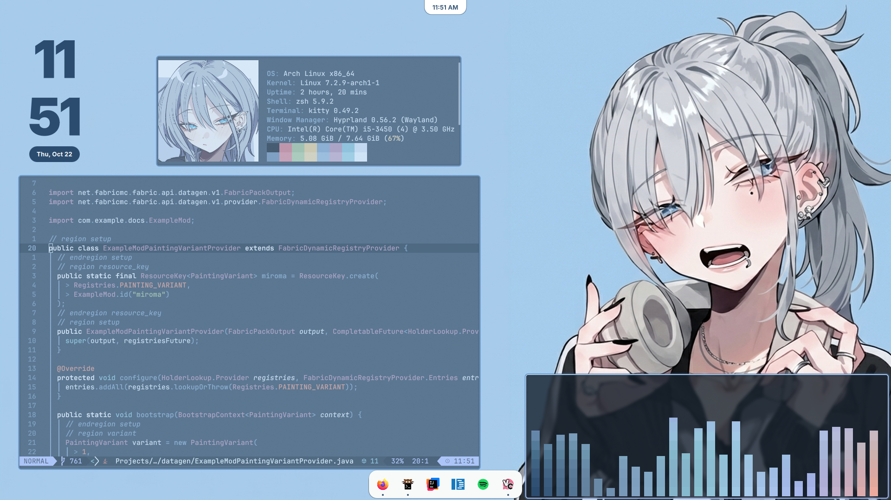

# dotfiles

My mostly vibe coded hyprland dots.

Hyprland + Quickshell shell, themed with the `haimiya` palette (cream / denim /
sky / peach): neovim, kitty, fastfetch, cava and spicetify all share it.

## Quick install

On a fresh Arch machine:

```sh
git clone https://github.com/NotNightSky/dotfiles.git ~/.dotfiles
~/.dotfiles/install.sh
```

The script installs packages (pacman + AUR), sets up zsh/powerlevel10k, checks
the dotfiles out into `$HOME`, syncs the neovim plugins and applies the
spotify theme.

Useful flags:

| flag | effect |
| --- | --- |
| `--dry-run` | print the commands instead of running them |
| `--no-packages` | skip package installation |
| `--no-shell` | skip oh-my-zsh / powerlevel10k |
| `--no-nvim` | skip the lazy.nvim plugin sync |
| `--no-apps` | skip the spotify / spicetify step |
| `--layout bare` | bare repo in `~/.dotfiles` with work-tree `$HOME` (default) |
| `--layout clone` | plain clone in `~/.dotfiles`, files copied into `$HOME` |

Re-running is safe: anything that gets overwritten is copied to
`~/.dotfiles-backups/<timestamp>/` first.

## Layout

The repo is kept in `~/.dotfiles` as a **bare** repo with `$HOME` as work tree,
so every tracked file is already in place and the `config` alias works out of
the box:

```sh
config status        # git --git-dir=$HOME/.dotfiles --work-tree=$HOME
config add -- <path>
config commit -m "message"
config pull
```

## Highlights

| tool | config |
| --- | --- |
| neovim | `~/.config/nvim` (LazyVim + `haimiya` colorscheme, `:Haimiya`, `<leader>cs`) |
| kitty | `~/.config/kitty/kitty.conf` (includes `house-dark.conf`) |
| fastfetch | `~/.config/fastfetch/config.jsonc` (`Mio.png` logo) |
| cava | `~/.config/cava/config` (`haimiya` / `haimiya-light`) |
| spicetify | `~/.config/spicetify/Themes/haimiya` |
| hyprland | `~/.config/hypr/hyprland.lua` |
| quickshell | `~/.config/quickshell/shell.qml` (dock, top bar, osd, notif center) |
